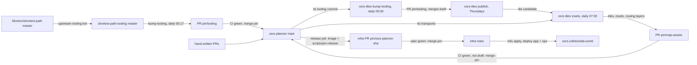

# Deployment flows

Production runs one image: the planner frontend and route service, built from a commit on `main`. Only
infra's `releases/osrs-planner.json` chooses which image runs. Everything else reaches production by
changing a pin in this repository. That makes a new commit on `main`, which builds a new image.

To see where every pin stands, run `scripts/pin-status`. It exits 1 when a pin is dirty. You don't
have to: `watch-pins.yml` checks daily and opens the issue **Automation needs attention** only when
something is stuck (see [Watching](#watching)).

## The pins

| Pin | Lives in | Moved by | When | Merges |
|---|---|---|---|---|
| Release image | infra `releases/osrs-planner.json` | `ci.yml` `release` job → `scripts/pin-release` → infra PR `pin/osrs-planner-<sha>` | every push to `main` | itself, once infra's tofu plan and checks pass; the merge applies and deploys |
| shortest-path-tooling | `tooling` submodule (`.gitmodules`: upstream `master`) | `bump-tooling.yml` → `scripts/bump-tooling` → PR `pin/tooling` | daily 05:17 UTC, or `gh workflow run bump-tooling -R collisionlab/osrs-planner` | itself, once CI passes |
| Shortest Path plugin | `tooling/shortest-path`, the commit tooling pins | upstream tooling's own bot (`chore: update shortest-path submodule to …`), then our tooling bump | when upstream tooling bumps it; ours follows the next day | with the tooling bump |
| Collision dumper for the tiles | osrs-tiles `flake.lock` `tooling` input | osrs-tiles `bump-tooling.yml` → its `scripts/bump-tooling` → osrs-tiles PR `pin/tooling`, to the tooling commit this repository pins | daily 05:50 UTC, when the dumper (`collision-map-update/`) differs | itself, once osrs-tiles' checks pass; the merge publishes a new tiles version |
| Tiles (every plane, both styles) | `tiles.json` `version` | osrs-tiles `publish.yml` renders and uploads; its `insets.yml` opens the PR `pin/map-assets` | Thursdays 06:00 UTC (game cache), a renderer or dumper push to osrs-tiles `main`, or a manual run | with the insets, below |
| Routing layers | `tiles.json` `routingLayers` | osrs-tiles `insets.yml` → `scripts/build-routing-layers` → the same PR `pin/map-assets` | when the planner's pinned plugin differs from the layers' (so after a tooling bump), at the next insets run | with the insets. They keep their own `tileVersion`: the tiles release whose collision is closest to the plugin's `collision-map.zip`, which may be older than the map's tiles; the manifest lists the squares that differ. The planner checks them against that tiles release, and the workbench's provenance line says when it isn't the map's. A failed build keeps the old layers and is a follow-up |
| Insets (metadata only) | `tiles.json` `insets` | osrs-tiles `insets.yml` → `scripts/pin-insets` → PR `pin/map-assets` | after each publish, an inset-code push to osrs-tiles `main`, daily 07:30 UTC | itself once CI passes, unless it is a **draft** waiting for you (the PR body says why) |

What tiles and inset bundles contain, and their URL layout, is in osrs-tiles' `docs/tiles.md`.

Nothing updates this repository's `flake.lock`, `package-lock.json` or the Gradle dependencies. Those change only through
hand-written PRs.

### Couplings to know

- **Tooling bumps can move the insets.** The inset version hashes the transports in this repository's
  pinned plugin (`tooling/shortest-path/.../transports`). A tooling bump that changes transport data
  therefore produces a new `pin/map-assets` PR at the next 07:30 run, even when the tiles are unchanged.
  If it makes a new area reachable, the PR lists the area as a follow-up to name (below) and still merges.
- **The plugin lags by up to two hops.** Skretzo's master moves first. Upstream tooling's bot pins it,
  and our 05:17 job picks that up. Being a commit or two behind Skretzo's master is normal and clean.
- **osrs-coord-preview pins only the tiles.** It reads every plane from the tiles, so its
  `pin/map-assets` PR (titled "Use tiles …") opens only for a new tile version, and waits as a draft only
  when the tiles changed a lot. Its release goes through infra's `releases/osrs-coord-preview.json`
  separately.
- **A merge to `main` deploys.** Every merge, whether it's a bot pin or a hand-written PR, releases
  without anyone stepping in. The tests in `ci.yml` are the only gate.

## How transport changes reach the insets, their labels and anchors

An inset bundle (osrs-tiles `scripts/build-insets`) is built in three layers, and each layer changes for
different reasons:

1. **Regions** (`regions.json`). The connected areas off the main map. They are discovered from the
   game cache's topology, so they change only with a new cache (the Thursday tiles) or a change to
   osrs-tiles' `InsetTopology`. Transports never create or remove regions.
2. **Reachability** (`anchors.json` `reachableRegionIds`). This is built from the transport rows in
   this repository's pinned plugin. A region is **reachable** when some chain of rows leads there, from
   the main world or from a row with no source (a spell, for example). Chains follow each row's own
   direction, ignore account requirements, and count every file: teleports, fairy rings, portals,
   levers and unusual actions ("Attract Light creature") all count. An area you can only leave is not
   reachable.
   **Anchors** (`anchors.json` `regions[id].anchors`) say where the planner places each area: beside a
   point on the main map, reached through physical connections where there are any, else through
   curated anchors or other transports. **Every reachable region needs one**; one without gets a
   `required-component-unanchored` issue in `review.json` and would show above the map. The rules are in
   osrs-tiles [`docs/tiles.md`](https://github.com/collisionlab/osrs-tiles/blob/main/docs/tiles.md#names-and-anchors).
3. **Labels** (`labels.json`, `review.json`). Labels are authored in osrs-tiles
   `data/inset-labels/annotations.json` (an interior seed tile and evidence per region) and
   `sources.json`. **Every reachable region needs one**, because the planner's area search
   (`AreaPicker`) lists only named regions (`src/map/insets/assets.ts`). A reachable region without an
   annotation gets the fallback name "Unidentified terrain at x, y" and a `required-component-unnamed`
   issue in `review.json`. Regions inside the main world don't need names.

The inset version hashes the transports (`transportsSha256`), so any transport edit triggers a rebuild:
the tooling bump at 05:17 is followed by a new bundle at 07:30 and a refreshed `pin/map-assets` PR. A
plugin change that adds a way into a new area therefore shows up the next morning as an unnamed
reachable region, and one reached only by teleport also as an unanchored one.

**Unnamed or unanchored reachable regions don't hold a pin back.** The pin PR lists them under
"Follow-ups" and merges once CI passes. Until they are fixed, the planner shows the coordinate label,
or shows the area above the map. Names already given survive transport edits upstream (osrs-tiles
`docs/tiles.md`). You can see the gaps in these places:

- `scripts/pin-status` lists them for the pinned bundle and for an open `pin/map-assets` PR. It also
  says when a bundle was built from transports other than the pinned plugin's, which means a rebuild
  is due;
- the `pin/map-assets` PR body;
- the osrs-tiles `insets` run summary (`reviewCount`) and its `inset-review` artifact;
- `https://tiles.collisionlab.world/insets/<version>/review.json`.

To name a region:

1. Add an area to `annotations.json` with its `componentId`, an interior `seed` (a landing tile works),
   `evidence` (the `c-…` ids of the rows landing there, plus any `s-…` source places inside it) and a
   `reason`. `scripts/label_inset_regions.py --worklist <file>` suggests evidence for each region.
2. Push it to osrs-tiles `main`. Changes under `data/inset-labels/` rerun `insets.yml`, which opens or
   refreshes the pin PR.

To anchor a region, give its annotation an `anchor`: a point on the main map, or inside an area that
has an anchor, and a `reason` (osrs-tiles `docs/tiles.md`). Push it the same way.

## When automation stops and waits for you

| Symptom | Why | What to do |
|---|---|---|
| `pin/tooling` open with red CI | the new tooling or plugin broke a contract (for example `CatalogTest`, `RouteSchemaTest`) or a build. Transport variables the account model can't set don't fail it: `RequirementCoverageTest` lists them as follow-ups | push the planner fixes to `pin/tooling`; the daily job won't overwrite a branch that has commits from anyone other than collisionlab-bot. CI passing then merges it |
| `pin/map-assets` open as a **draft** | something needs a person: the first insets, more than 10% of a style's tiles changed (`tile-review`), or more than 10% of inset areas changed (`compare-insets`) | follow the PR's **Action needed** list: check and mark it ready, and CI then merges it |
| osrs-tiles `pin/tooling` open with red CI | the new dumper doesn't compile against the tiles' RuneLite cache library, or broke a check | push fixes to osrs-tiles' `pin/tooling`; its daily job leaves a branch with someone else's commits alone |
| `pin/map-assets` open with red CI | `scripts/check-map-assets` found the tiles and insets incompatible, or a style's tiles missing a square an inset covers | fix in osrs-tiles; the next build refreshes the PR |
| infra `pin/osrs-planner-…` open | infra's plan or checks failed | fix in infra; nothing reaches production until it merges |
| live `/version` differs from the infra pin | deploy in progress, or the smoke checks refused the new release (blue/green keeps the old one) | check infra's `tofu` run on `main` |

A pin PR is a draft exactly while one of those reasons applies, and every refresh rewrites its "Action
needed" list. A refresh with nothing left marks it ready by itself. After you mark a PR ready, it stays
ready through refreshes that only repeat what it already listed, and goes back to draft if something new
appears. While a pin PR is open, the osrs-tiles runs build for its tiles, so a daily run never reverts a
tile update.

`pin/tooling` and `pin/map-assets` are fixed branch names that are refreshed in place, so at most one of
each is open. Infra opens one pin PR per planner commit.

## Watching

`watch-pins.yml` runs `scripts/watch-pins` daily at 09:45 UTC (or `gh workflow run watch-pins -R
collisionlab/osrs-planner`; `scripts/watch-pins --dry-run` prints what it would do). It keeps two
issues in this repository:

- **Automation needs attention**: a bot pin PR (here or in osrs-tiles) that is a draft, red for more than 6 hours, or open for
  more than 12; an infra release pin open for more than 12 hours; `main` not in infra's release pin, or
  the live `/version` not matching it, 3 hours after the commit; `bump-tooling`, `ci` on `main`, or
  osrs-tiles `bump-tooling`/`publish`/`insets` failing on their last two runs. It is created, or gets a comment, only
  when something new appears, and closes itself once everything is clear. Nothing else needs a
  person.
- **Follow-ups**: reachable inset areas without a name or anchor, or whose curated name lost its
  evidence (the pinned bundle's `review.json`), routing layers from another plugin commit than the
  pinned one, and transport variables no account fact sets (the
  latest `main` CI run's `requirement-gaps.md`, from `RequirementCoverageTest`). Its body is
  rewritten in place without notifying anyone.

It also closes infra `pin/osrs-planner-*` PRs that a newer merged pin has overtaken, so a failed
plan for an old release doesn't linger.

## Clean, current and dirty

`scripts/pin-status` checks the commit you have checked out (run it on `main` to see production's
inputs):

- **current**: at the head of the upstream branch it follows;
- **clean**: on that branch, maybe some commits behind; a scheduled job will catch it up;
- **dirty**: not on the upstream branch (a fork or rewritten commit), `.gitmodules` pointing at a fork, a
  local submodule checkout that differs from the commit (`git submodule update --init --recursive`), or
  insets built for other tiles.

It also shows whether `main`, infra's release pin and the live `/version` agree, and lists the open bot
PRs.

## Daily clock (UTC)

| Time | Job |
|---|---|
| hourly :17 | infra `uptime` |
| 03:17 | infra `tofu` drift check |
| 05:17 | `bump-tooling` (this repository) |
| 05:50 | osrs-tiles `bump-tooling` |
| Thu 06:00 | osrs-tiles `publish` |
| 07:30 | osrs-tiles `insets` |
| 09:45 | `watch-pins` (this repository) |
