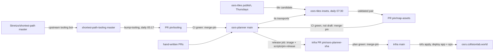

# Deployment flows

Production runs one image: the planner frontend and route service, built from a commit on `main`. Only
infra's `releases/osrs-planner.json` chooses which image runs. Everything else reaches production by
changing a pin in this repository. That makes a new commit on `main`, which builds a new image.

To see where every pin stands, run `scripts/pin-status`. It exits 1 when a pin is dirty.

## The pins

| Pin | Lives in | Moved by | When | Merges |
|---|---|---|---|---|
| Release image | infra `releases/osrs-planner.json` | `ci.yml` `release` job → `scripts/pin-release` → infra PR `pin/osrs-planner-<sha>` | every push to `main` | itself, once infra's tofu plan and checks pass; the merge applies and deploys |
| shortest-path-tooling | `tooling` submodule (`.gitmodules`: upstream `master`) | `bump-tooling.yml` → `scripts/bump-tooling` → PR `pin/tooling` | daily 05:17 UTC, or `gh workflow run bump-tooling -R collisionlab/osrs-planner` | itself, once CI passes |
| Shortest Path plugin | `tooling/shortest-path`, the commit tooling pins | upstream tooling's own bot (`chore: update shortest-path submodule to …`), then our tooling bump | when upstream tooling bumps it; ours follows the next day | with the tooling bump |
| Tiles | `tiles.json` `version` | osrs-tiles `publish.yml` renders and uploads; its `insets.yml` opens the PR `pin/map-assets` | Thursdays 06:00 UTC (game cache), a renderer push to osrs-tiles `main`, or a manual run | with the insets, below |
| Insets | `tiles.json` `insets` | osrs-tiles `insets.yml` → `scripts/pin-insets` → PR `pin/map-assets` here and in osrs-coord-preview | after each publish, an inset-code push to osrs-tiles `main`, daily 07:30 UTC | itself once CI passes, unless opened as a **draft** for review |

Nothing updates `flake.lock`, `package-lock.json` or the Gradle dependencies. Those change only through
hand-written PRs.

### Couplings to know

- **Tooling bumps can move the insets.** The inset version hashes the transports in this repository's
  pinned plugin (`tooling/shortest-path/.../transports`). A tooling bump that changes transport data
  therefore produces a new `pin/map-assets` PR at the next 07:30 run, even when the tiles are unchanged.
- **The plugin lags by up to two hops.** Skretzo's master moves first. Upstream tooling's bot pins it,
  and our 05:17 job picks that up. Being a commit or two behind Skretzo's master is normal and clean.
- **osrs-coord-preview receives the same `pin/map-assets` PRs.** Its release goes through infra's
  `releases/osrs-coord-preview.json` separately.
- **A merge to `main` deploys.** Every merge, whether it's a bot pin or a hand-written PR, releases
  without anyone stepping in. The tests in `ci.yml` are the only gate.

## When automation stops and waits for you

| Symptom | Why | What to do |
|---|---|---|
| `pin/tooling` open with red CI | the new tooling or plugin broke a guard (for example `RequirementCoverageTest`, `CatalogTest`, `RouteSchemaTest`) or a build | push the planner fixes to `pin/tooling`; the daily job won't overwrite a branch that has commits from anyone other than collisionlab-bot. CI passing then merges it |
| `pin/map-assets` open as a **draft** | first insets, more than the review threshold of tiles changed, or the inset geometry needs review | check the PR, then mark it ready; `ready_for_review` reruns CI, which merges it |
| infra `pin/osrs-planner-…` open | infra's plan or checks failed | fix in infra; nothing reaches production until it merges |
| live `/version` differs from the infra pin | deploy in progress, or the smoke checks refused the new release (blue/green keeps the old one) | check infra's `tofu` run on `main` |

`pin/tooling` and `pin/map-assets` are fixed branch names that are refreshed in place, so at most one of
each is open. Infra opens one pin PR per planner commit.

## Clean, current and dirty

`scripts/pin-status` checks the commit you have checked out (run it on `main` to see production's
inputs):

- **current**: at the head of the upstream branch it follows;
- **clean**: on that branch, maybe some commits behind; a scheduled job will catch it up;
- **dirty**: not on the upstream branch (a fork or rewritten commit), `.gitmodules` pointing at a fork, a
  local submodule checkout that differs from the commit (`git submodule update --init --recursive`), or
  insets built for other tiles.

It also shows whether `main`, infra's release pin and the live `/version` agree, and lists the open bot
PRs.

## Daily clock (UTC)

| Time | Job |
|---|---|
| hourly :17 | infra `uptime` |
| 03:17 | infra `tofu` drift check |
| 05:17 | `bump-tooling` (this repository) |
| Thu 06:00 | osrs-tiles `publish` |
| 07:30 | osrs-tiles `insets` |
